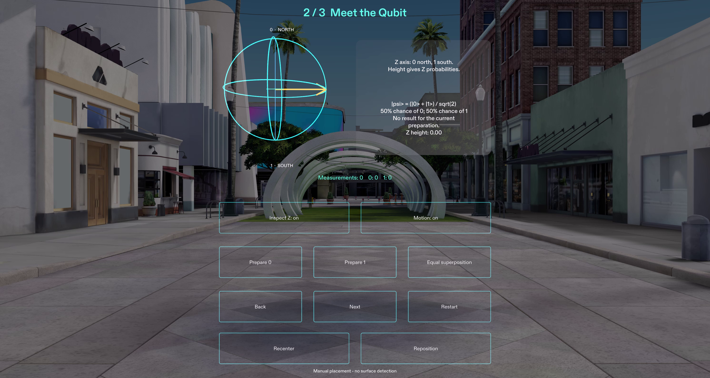

# Quantum AR Explorer

An educational augmented-reality project for the general public, including people
with no quantum computing background. Intended for Snap SPECS and the Learn AR with
SPECS competition.

Turn an ordinary view into a miniature laboratory for understanding quantum states.
Explore a classical bit, prepare a qubit, measure it and discover why repeating a
measurement differs from preparing a fresh experiment. After the three-stage lesson,
an optional gate lab reveals how phase can change a later outcome.

## Current development status

This repository contains a dependency-free scientific simulation, complete offline lesson
engine, accessible presentation models and a host session/focus boundary. It supports
back/restart, fresh-trial experiments, bounded history, challenge feedback and recovery.
The native SPECS project is in `native/QuantumARExplorer`. Its open 3D station uses
an 18 cm Bloch sphere, brief interruptible arrow transitions, a measurement-axis
inspection tool and project-owned charcoal/cyan/gold UIKit styling. The station
stays fixed as the simulated viewpoint moves; manual Recenter deliberately moves it.
Motion can be turned off without changing the science.

The optional X/H/Z lab has its own state and counters, displays complex amplitudes
and phase, and returns to the preserved completed lesson. Try H-Z-H from 0, then
compare H-H. The native components use supported SIK/UIKit controls in Lens Studio
5.23.2. See [verification](docs/public/VERIFICATION.md) for exact native and
reconstruction results. Physical glasses comfort and hand tracking have not been
tested. This is not a completed competition submission.

## Run the available tests

Use Node.js 24 or newer. No package installation is required.

```sh
node --test tests/*.test.js
node examples/offline-walkthrough.mjs
```

See [open and test instructions](docs/public/OPEN_AND_TEST.md) and
[scientific behavior and acceptance criteria](docs/public/SCIENCE_AND_ACCEPTANCE.md).
The [lesson API](docs/public/LESSON_API.md) describes the implemented contracts and
[native integration guide](docs/public/LENS_INTEGRATION_READINESS.md) describes the
module boundary and verified tooling. The CLI walkthrough is an offline demo,
not a Lens Studio preview.

## Open the Lens

Open `native/QuantumARExplorer/QuantumARExplorer.esproj` with Lens Studio 5.23.2.
Use the SPECS interactive preview. The laboratory uses explicitly labeled manual
placement; it does not recognize tables. Select controls with the supported
coordinate-pinch preview interaction. Mouse activation was not verified in the
current landscape setup; see the verification limits. See the [open and test guide](docs/public/OPEN_AND_TEST.md)
for native scenarios, package provenance and current limits, and the
[public planning brief](native/QuantumARExplorer/devpost/PUBLIC_DESIGN_BRIEF.md).

## Demonstration and submission materials



Genuine QAR-009 desktop preview in Lens Studio's simulated Sunlit Outdoor
environment. The current local V3 demonstration is 2:45, 1920 × 1080, 30 fps,
silent with English captions. It shows the lesson, brief manual placement and
the optional phase experiment. The QAR-008 fallback remains preserved. Physical
glasses testing has not occurred; the owner controls video upload and submission.

The [submission package](docs/public/SUBMISSION.md) explains the product, audience,
spatial design, implementation, disclosures, and remaining owner steps. Use the
[timed demonstration script](docs/public/DEMO_SCRIPT.md) and
[recording guide](docs/public/RECORDING_GUIDE.md) with the real preview.
[Verification](docs/public/VERIFICATION.md) distinguishes completed checks from
physical-device work and platform uploads.

## Rights and attribution

Copyright 2026 Veristio Intelligence Technologies, LLC. All rights reserved.
No permissive open-source license has been authorized. See
[third-party notices](THIRD_PARTY_NOTICES.md) for provenance and redistribution status.
