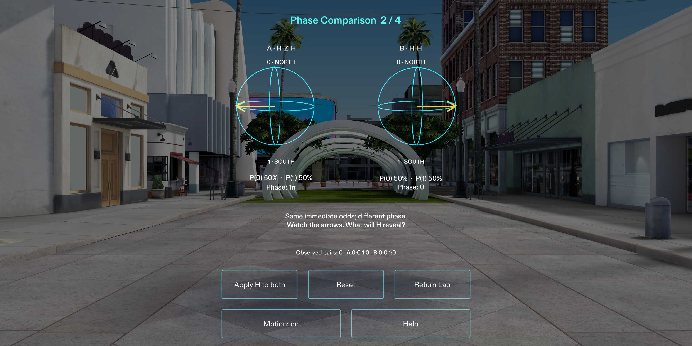

# Quantum AR Explorer

Discover quantum computing by experimenting with a miniature spatial laboratory.
Change a classical bit, prepare a qubit and measure it. Then compare two quantum
experiments: the same immediate odds can conceal a phase difference that changes
what happens next.

The native SPECS project is in `native/QuantumARExplorer`. Its three-stage beginner
lesson leads to a probability challenge and an optional independent X/H/Z lab.
The new Comparison Chamber places two 15 cm state diagrams side by side, showing
H-Z-H from 0 alongside H-H from 0. Intermediate phase, probabilities and final
predictions come from the same verified mathematics used by the original lab.

The world station uses larger labels, contextual Help, visible measurement Next,
an inspection axis and interruptible illustrative motion. Motion can be turned
off. Placement and Recenter are deliberate manual actions; there is no table
recognition or persistent physical anchor.

## Open and explore

Open `native/QuantumARExplorer/QuantumARExplorer.esproj` in **Lens Studio 5.23.2**.
Select SPECS 27 Interactive Preview and Sunlit Outdoor. Use the verified
CLAD/Lens Studio MCP coordinate-pinch route or the nine supplied LEAF scenarios.
Ordinary Windows mouse activation remains unresolved in this setup. The
[judge walkthrough](docs/public/OPEN_AND_TEST.md) gives fresh-target discovery,
selection, recovery and exact scenario instructions, including vendor prerequisites.



This is genuine Lens Studio simulated-preview evidence. Physical glasses, hand
tracking, additive-display contrast and wearer comfort remain untested. See
[verification](docs/public/VERIFICATION.md) for exact checks and limitations and
the [approved public planning brief](native/QuantumARExplorer/devpost/PUBLIC_DESIGN_BRIEF.md).

## Run the offline tests

Node.js 24 or newer; no package installation is required:

```sh
node --test tests/*.test.js
node examples/offline-walkthrough.mjs
```

The dependency-free core separates scientific state, lesson progression,
presentation and input/session boundaries from native rendering. Comparison
state, counts and history are isolated from the original lesson and lab. See
[science criteria](docs/public/SCIENCE_AND_ACCEPTANCE.md),
[lesson API](docs/public/LESSON_API.md) and
[native integration](docs/public/LENS_INTEGRATION_READINESS.md).

## Demonstration and submission

The current genuine preview demonstration is under three minutes, landscape,
silent with English captions. A same-timing silent narration-ready version and
timed script are available to the owner. The QAR-009 V3 and QAR-008 fallbacks are
preserved. No voice, physical-device footage or platform upload is implied.
Use the [submission copy](docs/public/SUBMISSION.md),
[timed script](docs/public/DEMO_SCRIPT.md) and
[recording guide](docs/public/RECORDING_GUIDE.md).

The owner reviews final materials, supplies the uploaded video URL, makes
eligibility/rights/legal attestations and personally submits the competition entry.
This repository is competition-facing source, not a completed submission.

## Rights and attribution

Copyright 2026 Veristio Intelligence Technologies, LLC. All rights reserved.
No permissive open-source license has been authorized. See
[third-party notices](THIRD_PARTY_NOTICES.md).
